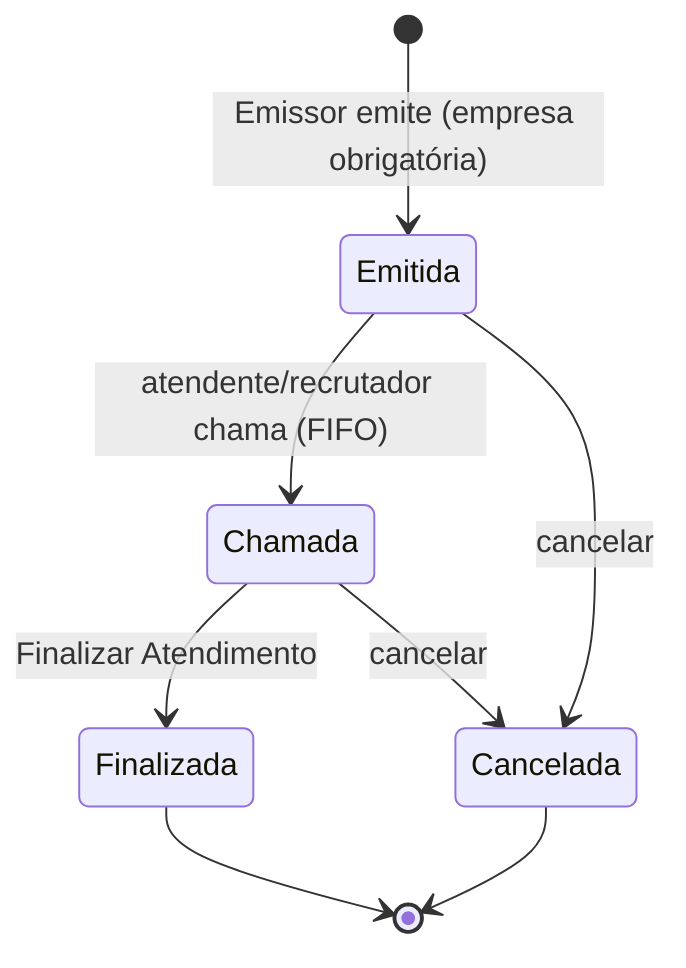
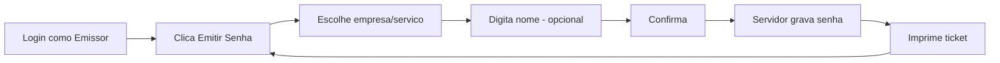
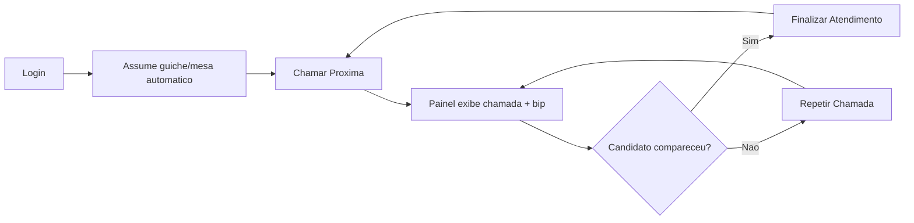
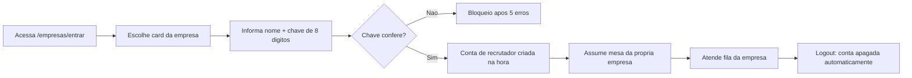
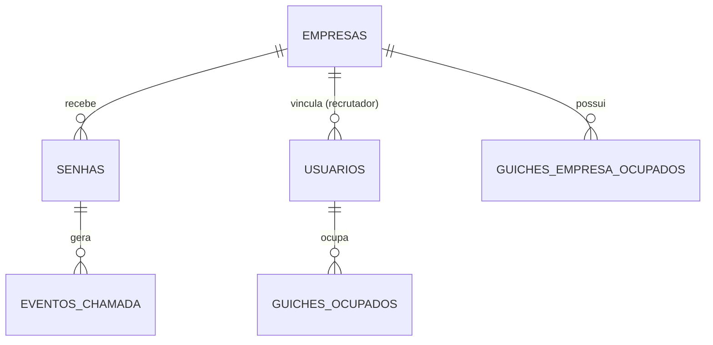

# SIGS — Documentação de Produto e Técnica

Data: 2026-09-24

Sistema Integrado de Gerenciamento de Senhas — SENAI. Documentação consolidada com 6 seções: PRD, TRD, App Flow, UI/UX Design, Esquema do Backend e Plano de Implementação, baseada no estado real do código-fonte (versão 2.23.0 + correções de gerenciamento de memória).

## 1. PRD — Documento de Requisitos do Produto

### 1.1 Visão geral

O SIGS gerencia a fila de atendimento de feirões de emprego do SENAI: emissão de senha impressa, chamada por guichê/mesa, e painéis públicos de acompanhamento. Cada empresa participante tem fila, numeração, painel e identidade visual próprios, além de um recrutador que atende sem precisar de cadastro prévio.

### 1.2 Problema que resolve

Um feirão reúne várias empresas entrevistando candidatos ao mesmo tempo, num mesmo espaço físico ou em salas separadas. Sem um sistema de senhas por empresa, cada uma teria que controlar sua fila manualmente (papel, chamada verbal), sem numeração confiável, sem histórico de quantos candidatos passaram, e sem um jeito de pausar a entrada de novos candidatos perto do encerramento sem perder o controle de quem já está na fila.

### 1.3 Usuários e perfis

| Perfil | Quem é | Ocupa guichê/mesa | Principais ações |
| --- | --- | --- | --- |
| Administrador | Equipe SENAI que organiza o evento | Não | Configurações, Relatórios de todas as empresas, gerenciar usuários e empresas, reiniciar contador, resetar histórico |
| Atendente | Equipe de apoio do SENAI | Sim (fila geral) | Chamar/repetir/finalizar senhas da fila geral, compartilhada entre empresas |
| Emissor de Senhas | Equipe de apoio, num totem de entrada | Não | Só emite senha (escolhe a empresa/serviço e imprime o ticket) |
| Recrutador | Funcionário da empresa participante | Sim (mesa da própria empresa) | Chamar/repetir/finalizar senhas só da própria empresa; bloquear/reativar emissão da própria empresa; ver relatórios só da própria empresa |

O recrutador não é cadastrado por um administrador: qualquer pessoa da empresa entra em `/empresas/entrar`, escolhe o card da empresa, informa o próprio nome e a chave de 8 dígitos gerada para aquela empresa. A conta é criada na hora e apagada ao deslogar.

### 1.4 Funcionalidades principais

- Emissão de senha com escolha obrigatória da empresa/serviço, numeração independente por empresa, impressão física via impressora térmica/comum do Windows.
- Chamada de senha por guichê (fila geral) ou por mesa (fila da empresa), com "Chamar Selecionadas" para chamar várias de uma vez.
- Painéis públicos sem login: painel geral de chamadas, painel por empresa, painel-resumo do feirão — pensados para TV/monitor.
- Bloqueio de emissão por empresa (reversível pelo próprio recrutador ou por um administrador), sem cancelar a fila já existente.
- Identidade visual por empresa (logo + cor, extraída automaticamente do logo enviado), aplicada no painel, na tela do recrutador e no ticket impresso.
- Relatórios com filtro por período e empresa, exportáveis em CSV, Excel e PDF, incluindo um dashboard analítico (BI) com gráficos de tendência, distribuição por status/hora e ranking por empresa.
- Dois serviços fixos sem fila ("Criar Currículos", "Imprimir Currículos") para apoio ao candidato antes de entrar na fila de uma empresa.

### 1.5 Fora de escopo (nesta versão)

- Multi-servidor / balanceamento de carga (o SQLite é de arquivo único).
- Autenticação externa (LDAP/AD) — preparada na arquitetura, não implementada.
- Aplicativo móvel nativo — hoje é só web responsiva.
- Notificação por SMS/e-mail ao candidato — hoje o aviso é só visual (painel) e sonoro (bip).
- Suporte a múltiplas unidades do SENAI num mesmo banco — a tabela `configuracoes` é única por instalação.

### 1.6 Métricas de sucesso

- Tempo de atendimento por empresa (intervalo entre chamada e finalização), já calculado e exportável em Relatórios.
- Taxa de atendimento (chamadas realizadas ÷ senhas emitidas) e volume de canceladas, ambos no resumo do período.
- Zero senha "perdida" (nunca emitida sem ser eventualmente chamada, cancelada ou finalizada, dentro do expediente do evento).

## 2. TRD — Documento de Requisitos Técnicos

### 2.1 Stack

| Camada | Tecnologia |
| --- | --- |
| Backend | Python 3.10+, Flask >=3.0.3, Werkzeug >=3.0.3 |
| Banco de dados | SQLite (arquivo único, WAL) — sem servidor separado |
| Servidor WSGI (produção) | waitress >=3.0.0, `threads=64`, porta 5000 |
| Impressão física | pywin32 (win32print/win32ui/win32con) — só Windows |
| Imagem/logo | Pillow >=10.4.0 |
| Relatórios | openpyxl >=3.1.5 (Excel), reportlab >=4.2.5 (PDF) |
| Frontend | HTML5/CSS3/JavaScript vanilla, sem framework/build step; gráficos SVG próprios (sem biblioteca externa) |
| Testes | pytest (`tests/`, banco isolado por teste) |

### 2.2 Arquitetura em camadas

`app.py` contém só rotas Flask e nunca acessa o SQLite diretamente — chama `database.py`, que concentra todo o SQL. `auth.py` isola login/sessão/perfis. `printer.py` isola a impressão física (GDI). `config.py` isola caminhos, logger e configurações persistidas. `models.py` define as estruturas de dados (`Senha`, `Empresa`, `Usuario`, `ChamadaEvento`). Templates Jinja2 em `templates/`, JS/CSS estáticos em `static/`.

### 2.3 Requisitos não funcionais

- **Concorrência**: dimensionado para ~31 conexões simultâneas (24 empresas + 6 pontos de emissão + 1 painel de TV), respondendo em ~0,15s num teste de carga simulado (ver README, seção 2.2).
- **Disponibilidade**: processo único no `wsgi.py`, pensado para rodar o dia inteiro do evento; recomenda-se inicialização automática via Agendador de Tarefas do Windows.
- **Rede**: rede local apenas (LAN), sem exposição à internet nesta configuração; servidor recomendado em cabo, clientes podem estar no Wi-Fi.
- **Persistência de log**: `sigs.log` com rotação por tamanho (5 MB, 5 backups), tabela `logs` no banco para consulta via sistema.
- **Portabilidade**: a parte web roda em Linux/Mac para desenvolvimento; a impressão física exige Windows (dependência de `pywin32`).

### 2.4 Segurança

- Todas as consultas SQL usam parâmetros (`?`) — sem SQL injection.
- Senhas de usuário: hash PBKDF2 via `werkzeug.security`, nunca texto puro.
- Limite de 5 tentativas de login (usuário ou chave de empresa) em 5 minutos, bloqueio temporário de 5 minutos, estado em memória com purga ativa de entradas expiradas.
- Comparação de senha e de chave de acesso em tempo constante (hash fantasma / `hmac.compare_digest`), contra ataques de enumeração e timing.
- Login obrigatório em toda rota operacional/administrativa; só `/painel*`, `/health`, `/login` e `/empresas/*/entrar` são públicas.
- Escopo por empresa (fila, chamadas, relatórios) sempre resolvido pelo `empresa_id` da sessão no servidor, nunca por valor enviado pelo cliente.
- `secret.key`, `database/*.db*` e `sigs.log` fora do controle de versão (`.gitignore`); a chave de acesso das empresas é armazenada em texto puro no banco — risco aceito, avaliado e documentado, dado que o sistema roda em rede local fechada, sem publicação na web.
- Recomendação pendente (não implementada): HTTPS via proxy reverso e cookies `Secure`, necessário apenas se o sistema deixar de rodar numa rede interna confiável.

### 2.5 Distância de outros bancos de dados

SQLite foi escolhido de propósito (instalação de arquivo único, sem serviço externo). Migrar para PostgreSQL (primeira escolha caso necessário), SQL Server Express ou MySQL/MariaDB exigiria reescrever `database.py` inteiro, pois o código usa SQL específico do SQLite (`PRAGMA`, `sqlite3.Row`, funções de data próprias).

## 3. App Flow

### 3.1 Ciclo de vida de uma senha

Uma exceção: senhas emitidas para "Criar Currículos"/"Imprimir Currículos" nascem direto como Finalizada (não passam por fila nem chamada).

### 3.2 Fluxo do Emissor (totem de entrada)

### 3.3 Fluxo do Atendente / Recrutador

### 3.4 Fluxo do Recrutador: entrada por chave (sem cadastro prévio)

### 3.5 Fluxo do Administrador

Login → acessa Configurações, Relatórios, Gerenciar Usuários ou Gerenciar Empresas pelo menu superior. Não ocupa guichê nem opera fila — papel de gestão, não de atendimento. Pode cadastrar empresa (gera chave de 8 dígitos automaticamente), enviar logo, ajustar cor, reiniciar contador (de uma empresa ou de todas), resetar senha de outro usuário, ou apagar todo o histórico de senhas (ação irreversível, exige confirmação explícita).

### 3.6 Painéis públicos (sem login)

| Painel | URL | Mostra |
| --- | --- | --- |
| Geral de chamadas | `/painel` | Última chamada + histórico recente, todas as empresas |
| De uma empresa | `/painel/empresa/<id>` | Chamada atual + últimas senhas, só daquela empresa |
| Resumo do feirão | `/painel/geral` | Totais aguardando/em atendimento por empresa |

Nenhum painel público mostra senhas Finalizada ou Cancelada — só a situação atual da fila.

## 4. UI/UX Design

### 4.1 Telas do sistema

| Tela | Rota | Público-alvo |
| --- | --- | --- |
| Login | `/login` | Admin, atendente, emissor |
| Acesso de empresa | `/empresas/entrar` → `/empresas/<id>/entrar` | Recrutador |
| Tela principal | `/` | Emissor, atendente, recrutador |
| Painel geral | `/painel` | Público (TV/monitor) |
| Painel de empresa | `/painel/empresa/<id>` | Público (TV/monitor da sala da empresa) |
| Painel-resumo | `/painel/geral` | Público |
| Configurações | `/configuracoes` | Admin |
| Relatórios | `/relatorios` | Admin, recrutador (só própria empresa) |
| Gerenciar usuários | `/admin/usuarios` | Admin |
| Gerenciar empresas | `/admin/empresas` | Admin |

### 4.2 Identidade visual

Cor institucional padrão `#003C71` (azul SENAI), configurável em Configurações. Cada empresa pode sobrescrever essa cor e o logo em suas próprias telas (painel da empresa e tela do recrutador vinculado a ela) — a cor é extraída automaticamente do logo enviado (média de cor da imagem), com opção de ajuste manual. Suporte a tema claro/escuro (`tema.js`), variáveis CSS (`var(--cor-...)`) para os gráficos do dashboard se adaptarem automaticamente.

### 4.3 Padrões de interação

- **Sem autocadastro**: toda conta (exceto recrutador) é criada por um administrador; não existe tela pública de "criar conta".
- **Guichê/mesa automático**: atendente e recrutador nunca escolhem guichê manualmente — o sistema atribui o primeiro disponível no login e libera no logout.
- **Confirmação explícita para ações irreversíveis**: bloquear emissão, resetar histórico e regenerar chave de acesso pedem confirmação antes de executar.
- **Feedback sonoro**: bip via Web Audio API (`bip.js`) ao chamar uma senha, com botão de teste em Configurações.
- **Polling, não WebSocket**: painéis e telas de fila atualizam por polling configurável (`tempo_atualizacao_ms`, padrão 2000ms) — escolha simples que evita infraestrutura de WebSocket para a escala do sistema.
- **Mensagem no WhatsApp pronta**: botão na tela Empresas já monta o texto com o link e a chave de acesso, para o admin só colar e enviar.

### 4.4 Dashboard Analítico (Relatórios)

Cinco gráficos SVG nativos (sem biblioteca externa, `dashboard-charts.js`): linha de tendência (emissões por dia), barras verticais (por hora), barras horizontais de ranking (por empresa), gráfico comparativo (total vs. atendido) e rosca (distribuição por status). Filtros por período com presets rápidos (hoje, últimos 7 dias, etc.) e por empresa (só visível ao admin).

## 5. Esquema do Backend

### 5.1 Tabelas (SQLite)

**senhas** — id, numero, status (Emitida/Chamada/Finalizada/Cancelada), data_hora, guiche, usuario, empresa (texto legado), empresa_id (FK empresas), hora_chamada, hora_finalizada, nome_pessoa.

**eventos_chamada** — id, senha_id (FK senhas), numero, guiche, usuario, data_hora, lote_chamada (agrupa eventos de uma mesma operação de "Chamar Selecionadas").

**empresas** — id, nome (único), ativa, data_criacao, logo_path, cor_principal, contador_atual, atendimento_finalizado_em, emissao_bloqueada_em, chave_acesso (8 dígitos, texto puro), fixa (marca as duas empresas de serviço "Criar/Imprimir Currículos").

**usuarios** — id, nome_completo, login (único), senha_hash, perfil, ativo, data_criacao, ultimo_login, empresa_id (FK empresas, só para recrutador), provisionado_por_chave (marca contas efêmeras de recrutador).

**guiches_ocupados** — guiche (PK, fila geral), usuario_id (FK usuarios), usuario_nome, ocupado_desde.

**guiches_empresa_ocupados** — chave primária composta (empresa_id, guiche), usuario_id (FK usuarios), usuario_nome, ocupado_desde.

**logs** — id, data_hora, nivel, mensagem.

**configuracoes** — chave (PK), valor — par chave/valor para nome do evento, quantidade de guichês/mesas, tempo de atualização do painel, cor principal, frase do menu, etc.

Índices: `idx_senhas_status`, `idx_eventos_data`, `idx_usuarios_login`, `idx_empresas_ativa`.

### 5.2 Relacionamentos

### 5.3 Rotas de API (JSON)

| Rota | Acesso | Função |
| --- | --- | --- |
| `POST /api/emitir` | Login | Emite senha (grava + imprime), `empresa_id` obrigatório |
| `POST /api/chamar` | Login | Chama próxima da fila (FIFO, escopo automático por empresa) |
| `POST /api/chamar-varias` | Login | Chama várias senhas de uma vez, mesmo lote |
| `POST /api/repetir` | Login | Repete última chamada do próprio guichê/mesa |
| `POST /api/finalizar-atendimento` | Login | Finaliza e já chama a próxima |
| `POST /api/reiniciar` | Admin | Reinicia contador de todas as empresas |
| `GET /api/painel/status` `/empresa/<id>/status` `/geral/status` | Público | Dados consumidos pelos painéis (polling) |
| `GET /api/fila` | Login | Fila paginada, com busca |
| `POST /api/senha/<id>/finalizar` `/cancelar` `/reimprimir` | Login | Ações sobre uma senha específica |
| `GET/POST /api/config` | Admin | Lê/atualiza configurações |
| `GET /api/impressoras` | Login | Lista impressoras instaladas |
| `GET /api/empresas` | Login | Empresas ativas com emissão liberada |
| `POST /api/bloquear-emissao` `/reativar-emissao` | Recrutador | Bloqueia/reativa emissão da própria empresa |
| `GET /api/relatorios/{csv,excel,pdf,resumo}` | Admin/Recrutador | Exporta/consulta relatórios; `resumo` alimenta o dashboard |
| `GET /api/relatorios/empresas/pdf` | Admin/Recrutador | PDF institucional "Senhas por Empresa" |
| `POST /api/admin/usuarios` e sub-rotas | Admin | CRUD de usuários, reset de senha, perfil, empresa, status |
| `POST /api/admin/reset-senhas-emitidas` | Admin | Apaga todo o histórico (exige `{"confirmar": true}`) |
| `GET/POST /api/admin/empresas` e sub-rotas | Admin | CRUD de empresas, chave, logo, cor, contador, reativação |

Lista completa (incluindo rotas HTML) na seção 12 do README.md do projeto.

## 6. Plano de Implementação

### 6.1 Como o sistema foi construído (histórico real, versão atual 2.23.0)

| Fase | Entregou |
| --- | --- |
| Base (v1.x) | Fila única, emissão/chamada/finalização, painel público, impressão via GDI |
| Empresas do feirão (v2.0–2.3) | Cadastro de empresas, numeração e logo/cor por empresa, filtro em relatórios |
| Login e perfis (v2.3–2.7) | `auth.py`, 4 perfis, guichê automático, hash de senha |
| Recrutador por chave (v2.4) | Acesso sem cadastro prévio, conta efêmera, proteção de força bruta |
| Painéis por empresa (v2.8–2.12) | Painel dedicado, painel-resumo, mesas por empresa |
| Bloqueio de emissão e relatórios do recrutador (v2.14–2.17) | Bloquear/reativar por conta própria, acesso restrito a Relatórios |
| Revisão sênior de segurança e performance (v2.20–2.21) | WAL, locks por empresa, PRAGMAs, correção de contagem de canceladas |
| Reimpressão e nome opcional (v2.22) | Segunda via marcada "REIMPRESSO", campo "Primeiro Nome" |
| Dashboard Analítico e PDF institucional (v2.23) | 5 gráficos SVG, filtros de período, exportação PDF com identidade visual |
| Auditoria de segurança e gestão de memória (atual) | `.gitignore` para segredos, rotação de `sigs.log`, purga ativa do rate-limit, liberação explícita de fontes GDI, fechamento explícito de conexões do `ConfigManager` |

### 6.2 Débito técnico conhecido e aceito

- `chave_acesso` das empresas fica em texto puro no banco — aceito por ser rede local fechada, sem publicação na web (decisão revisitada com o responsável pelo sistema).
- Sem HTTPS/cookies `Secure` — só necessário se o sistema sair da rede interna.
- Sem histórico de git limpo de commits antigos que continham segredos (o `.gitignore` foi adicionado depois; os arquivos já saíram do rastreamento e a chave foi rotacionada, mas commits antigos no histórico local não foram reescritos).

### 6.3 Próximos passos possíveis (não iniciados)

- Substituir o logo placeholder (`static/img/logo.png`) pelo logotipo oficial antes de um evento real.
- Considerar hashear `chave_acesso` se o sistema algum dia sair de uma rede fechada.
- Explorar as expansões já mapeadas na arquitetura (seção 11 do README): voz chamando senha via Web Speech API, QR Code na emissão, integração LDAP/AD, multi-unidade.

---

*Fonte: [documento vivo no Claude](https://claude.ai/code/artifact/c8511abc-91bc-4133-bf37-1a6f94926399), gerado a partir do código-fonte real do SIGS.*
